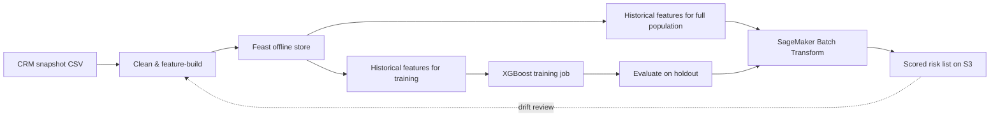

# Problem Framing & Business Trade-offs

In subscription businesses, acquiring a new customer costs five to twenty-five times more than retaining an existing one. For a telecommunications provider, **customer churn** — a subscriber cancelling service — is the single largest driver of revenue leakage. This project frames churn as a periodic **batch scoring** problem: every night (or billing cycle), score the entire active customer base and hand retention teams a ranked risk list before the customer ever calls to cancel.

## 1. The Business Objective & Operational Impact

The high-level goal is to **maximize retention-campaign ROI**: interventions (discount offers, plan upgrades, support outreach) are expensive and finite, so they must be concentrated on the customers most likely to leave *and* most valuable to keep.

### Cost-Benefit Trade-offs in Scoring Errors

Prediction errors are not symmetric in their operational impact:

*   **False Positive (flagged churner who stays)**:
    *   *Operational Consequence*: The retention team spends budget — a discount, a call, a contract renegotiation — on a customer who was never leaving.
    *   *Business Penalty*: Direct campaign cost plus margin erosion when a discount is applied to revenue that was never at risk. In aggregate, excessive false positives train the organization to distrust the model.
*   **False Negative (missed churner)**:
    *   *Operational Consequence*: A customer at real risk receives no intervention and cancels.
    *   *Business Penalty*: Lost recurring revenue plus replacement acquisition cost. Because intervention is the only lever, a missed churner is a permanently lost opportunity.

For churn, **recall dominates**: the cost of a missed churner (lost lifetime value) typically exceeds the cost of a wasted intervention by an order of magnitude. We therefore operate the classifier at a decision threshold that favors recall, and we report **AUC** (ranking quality) rather than raw accuracy — the campaign cares about *ordering* customers by risk, not about the 0.5 cutoff.

### Why Batch, Not Real-Time?

Churn signals are slow-moving subscription attributes — tenure, contract type, billing amounts, service add-ons — refreshed when billing systems close a cycle, not when a customer clicks. Nothing actionable arrives per-request:

*   There is no synchronous decision to answer. Nobody asks "will this customer churn in the next 200 ms?"; the retention team works a ranked list produced on a schedule.
*   A real-time endpoint would sit idle between billing cycles while still paying for uptime.
*   **Batch Transform** (SageMaker's offline inference job) spins up a serving container, streams the whole population through the model, writes one prediction file per input, and exits — paying only for the scoring run.

This is the canonical *score-the-population* topology: **Feast offline store** for point-in-time feature retrieval, **SageMaker Batch Transform** for scoring, both running fully offline against moto-backed S3.

---

## 2. Machine Learning Task Formulation

We frame this as a **binary classification task**:

*   **Target**: $y \in \{0, 1\}$ — whether the customer churned in the observed period.
*   **Features**: subscription attributes from the CRM snapshot — contract type, tenure, monthly/total charges, service add-ons, billing method.
*   **Scoring unit**: every active `customer_id` in the base, scored on the snapshot reference date.

### Mathematical Target Definition

Given a customer entity $c$ with feature vector $\mathbf{x}_c$ known at the snapshot date $t$, the model estimates:

$$\hat{p}_c = P(\text{churn} = 1 \mid \mathbf{x}_c)$$

The deliverable is the ranked population $(\hat{p}_c, c)$ sorted descending — a campaign list, not a per-request answer.

---

## 3. Project Goal & Pipeline Architecture

This project implements a production-grade, end-to-end MLOps pipeline inside the repo's fully-offline Docker stack: **moto** emulates S3/STS, **SageMaker local mode** runs training and transform jobs in local containers, and **Feast** supplies the feature store layer (DuckDB-backed offline store — no online serving is needed because nothing is scored per-request).

Because every stage runs inside Docker containers declared in this project's `docker-compose.yml`, the reader can reproduce the entire lifecycle — collection through monitoring — without any AWS account.
